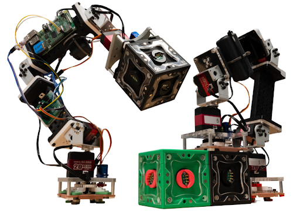

Design notes: [docs/design.md](docs/design.md)

## Starting up
# Create a virtual environment
python -m venv .venv

# Activate it
.venv\Scripts\activate

# install dev dependencies
python -m pip install -e ".[dev]"

## Test Models
# Test Manual Grab
python scripts/test_grab.py

# Test Walk (placeholder, not implemented yet)
python scripts/run_gait.py

# Build a goal structure interactively
python scripts/test_build_goal_struct.py

# Generate an example scene XML (models/generated_scene.xml, not committed)
python scripts/generate_multi_block_scene.py

# View the multi-block layout without moving the arm
python scripts/load_scene.py

# Move, grab, and place a block through SimBridge
python scripts/demo_grab_multi.py

The interactive demos generate their block bodies, face sites, and welds at
startup from the shared layout in `inchworm_sim/scene_layout.py`. The generated
runtime XML is temporary; edit that Python layout instead of hand-editing block
coordinates in XML.

Inchworm structure
ee1 (root) → [left_wrist, left_hand] → link1 → [top] → link2 → [right_hand, right_wrist] → ee2
