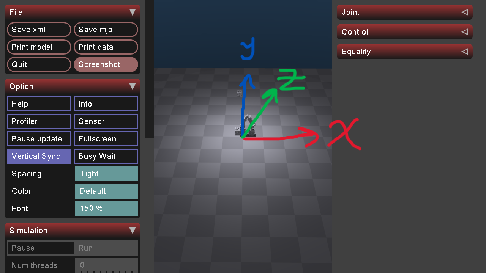
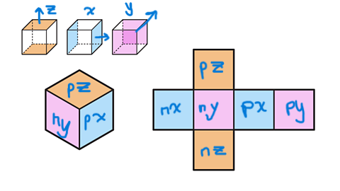
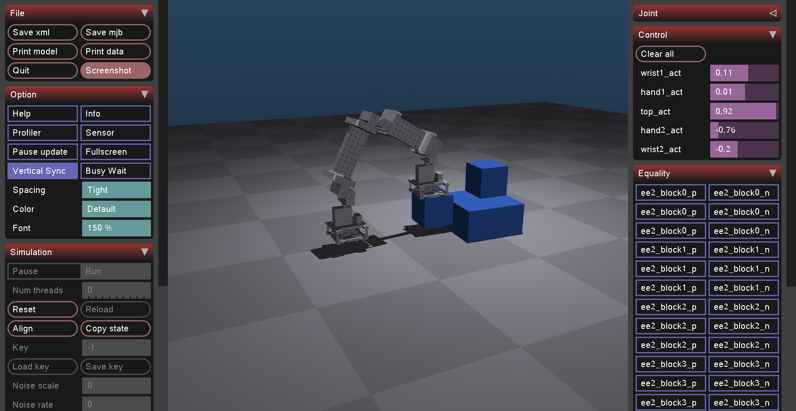

# Inchworm Sim: Design

## Goal (~2 weeks)
Logical world + MuJoCo viewer that can replay a sequence of
actions (move, place, remove) toward a target structure.

## Conventions
- Axes: z is up. Origin (0,0,0) is the corner of the ground plane.

- Grid cells indexed from 0. Block edge = 0.0742 m (just under 3 inches).
- Horizontal grid coordinates may be negative within the configured bounds;
  height coordinates must have `z >= 0`.
- Faces are `px`, `nx`, `py`, `ny`, `pz`, and `nz` (positive or negative
  x, y, z) in logic, MuJoCo site names, and weld names alike. They are
  defined once in `inchworm_sim/bridge/faces.py`.

## Entities
- Block: id, grid position, face connection
- Inchworm: id, block location and face its on for each EE
    - Only attach to faces

## Actions
Step(direction), placeBlock(face), removeBlock(face)
    connect(endeffector), disconnect(endeffector)

## Validity rules
1. Target cell must be in bounds and empty
2. Placed block must touch ground or another block
3. Block cannot be removed if another block is ontop of it

## Layers and ownership
- core/ (Person A), physics/ (Person B). Core never imports mujoco.
- `inchworm_sim.bridge` (`scene_builder`) generates scenes with any number of
  reusable block bodies from logical grid coordinates.
- `inchworm_sim.scene_layout` owns the starting block IDs and grid coordinates.
  Demo scenes generate MuJoCo block bodies, face sites, and welds at runtime;
  those instance details are not maintained in the base scene XML.
- `models/block.xml` is a one-block reference for dimensions, mass, and face
  sites. It is not the source of the demo block count or starting positions.

The screenshot is from `physics-B2`, before the merge. It shows the earlier
`block0`-based ids and body welds; current scenes use `block1` and up and the
`ee2_{block_id}_{site}_weld` face welds.

## Attachment
- One site per block face (`blockN_px`, ...), in the block frame. Block-to-block
  and gripper welds share these sites.
- The gripper carries six rotated sites, `ee2_grab_px` ... `ee2_grab_nz`, at
  the `ee2_grab` point. Weld `ee2_blockN_{site}_weld` joins `ee2_grab_{site}`
  to `blockN_{site}`, so the grabbed face sits flush and the cube's sides stay
  parallel to the gripper.
- Held blocks are re-aligned to the gripper after every physics step; placed
  blocks are snapped to their grid cells.

## Open questions
- How are block orientations addressed, specifically when blocks are rotated?

## Decisions log
- 2026-10-22: Initial design in progress
- 2026-11-05: Grabs keep six face-specific site welds (not physics-B2's
  body-to-body weld). Face rotation moved to six `ee2_grab_{site}` sites so
  each block face has a single site. Held blocks follow the gripper rigidly
  because the soft weld alone lagged up to ~20 mm and ~18 degrees.
- 2026-11-09: Added validity rules and an open question